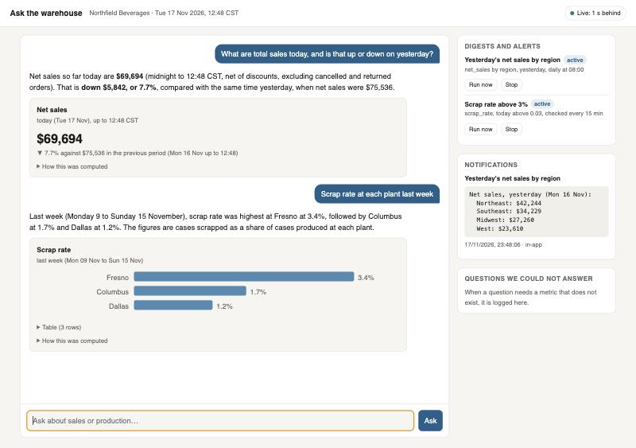
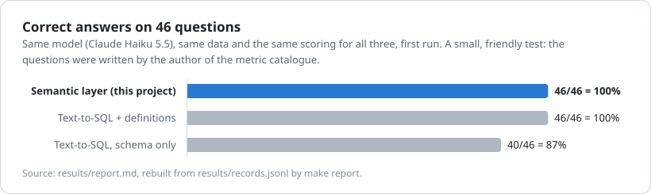
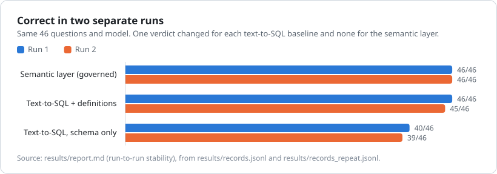
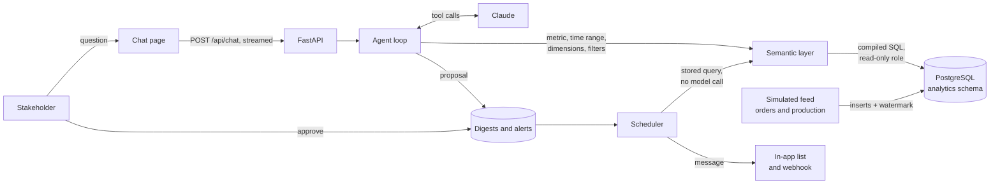

# ask-the-warehouse

[](https://github.com/linusdominic/ask-the-warehouse/actions/workflows/ci.yml)

Ask "what are total sales today?" and get the number, how it was computed, and how fresh
the data is, without opening a dashboard. Answers come from governed metric definitions over
near-real-time data, and the app can also send them on a schedule or alert on a threshold.



<picture>
  <source media="(prefers-color-scheme: dark)" srcset="docs/img/architecture-dark.svg">
  
</picture>

It is a portfolio project. It runs on a laptop against PostgreSQL with simulated data and
has not been deployed anywhere. Every number below comes from a run on my machine on
17 November 2026, and the command that reproduces it is next to it.

## The problem

At a previous company I built the first version of this idea. Sales and production data
sat in a lakehouse and in Redshift, refreshed in near real time, and stakeholders stopped
opening dashboards: they asked a language model what total sales were today, and got the
figure. This repository is how I would build that now.

Connecting a model straight to a warehouse works until it matters. The same question can
be answered with two different numbers, because "sales" can be read as net or gross and
"today" as a UTC day or a business day. Nobody can say afterwards how a figure was
computed. A vague question gets a confident answer. And it only speaks when spoken to,
which is not what a dashboard on a wall is for.

## What it does

| Weakness of "a model writes SQL against the warehouse" | What this does |
| --- | --- |
| The model decides what "sales" means each time | Metrics are defined once in [semantic/metrics.yml](semantic/metrics.yml). The model picks a metric, a time range, dimensions and filters. Code writes the SQL |
| "Today" and "last week" are whatever the query says | Business time is resolved in code, in the company's time zone, and stated in every answer |
| No way to tell whether answers are right | A hand-written evaluation set with independent reference SQL, run against two text-to-SQL baselines |
| A vague question gets a confident answer | The agent asks which metric is meant, and uses stated defaults where one exists |
| Nobody knows how fresh a number is | Every result carries the pipeline's watermark, and stale data is flagged |
| The model can run anything | There is no tool that accepts SQL. Queries run under a database role that can only read |
| It only answers when asked | Digests on a schedule and alerts on a threshold, created in conversation and approved by a person |
| Unanswerable questions vanish | They are logged as a backlog of metrics the data team has not defined yet |

## Results

The evaluation asks 46 questions of three approaches that all use the same model
(Claude Haiku 5.5) and the same data.

<picture>
  <source media="(prefers-color-scheme: dark)" srcset="docs/img/results-dark.svg">
  
</picture>

| Approach | Correct (95% CI) | Both phrasings of a question correct | Latency p50 | Cost per question |
| --- | --- | --- | --- | --- |
| Semantic layer (this project) | 46/46 = 100% (92% to 100%) | 23/23 | 1.9 s | $0.00118 |
| Text-to-SQL with the metric definitions in the prompt | 46/46 = 100% (92% to 100%) | 23/23 | 3.1 s | $0.00089 |
| Text-to-SQL with the schema only | 40/46 = 87% (74% to 94%) | 19/23 | 3.3 s | $0.00070 |

`make eval` produced these; `make report` rebuilds them from
[results/records.jsonl](results/records.jsonl). Full tables are in
[results/report.md](results/report.md).

**What the numbers say**

- **The definitions matter more than the mechanism.** With the metric definitions written
  into its prompt, a model writing its own SQL scored the same as the semantic layer. The
  semantic layer did not win on accuracy on this question set.
- **Without the definitions, the model guesses, and guesses plausibly.** The schema-only
  baseline got 6 of 46 wrong in the first run (p = 0.031 against the semantic layer, exact
  McNemar test). Four of the six were definitions it could not have known: gross sales and
  return rate. Each wrong answer was fluent, specific and explained.
- **The semantic layer was faster and dearer.** It does not have to write SQL, so its median
  answer took 1.9 s against 3.1 s. Its tool definitions and catalogue make every request
  larger, so it cost a third more per question.
- **Its advantage is what cannot go wrong, not what did.** In a second run the baseline with
  definitions wrote `TIMESTAMP '2026-11-09 00:00:00-06'`. PostgreSQL silently drops the
  offset from that literal, so the week started six hours early and the answer was wrong.
  The semantic layer cannot make that mistake, because the model never writes a timestamp.

<picture>
  <source media="(prefers-color-scheme: dark)" srcset="docs/img/runs-dark.svg">
  
</picture>

| Approach | Correct in run 1 | Correct in run 2 | Questions whose verdict changed |
| --- | --- | --- | --- |
| Semantic layer (governed) | 46/46 | 46/46 | 0 |
| Text-to-SQL + definitions | 46/46 | 45/46 | 1 |
| Text-to-SQL, schema only | 40/46 | 39/46 | 1 |

Forty-six questions written by the author of the metric catalogue is a small, friendly
test. The [limitations](#limitations) say what it does not show.

## Architecture



One request, end to end:

1. The chat page posts the question. The reply is a stream of server-sent events.
2. The model sees the metric catalogue and calls `query_metric` with a structured request,
   for example `{metric: net_sales, time_range: {preset: today}, dimensions: [region]}`.
3. The semantic layer checks the request against the catalogue, resolves the time window in
   the business time zone, compiles one SQL statement and runs it as a read-only role.
4. The tool result carries the rows, the exact window, the metric's definition and the
   pipeline watermark. The model writes a short answer from it.
5. The page shows the answer, a chart or table, and the SQL and definition behind it.

## Quickstart

Needs [uv](https://docs.astral.sh/uv/), Docker, and an Anthropic API key for the chat.

```bash
git clone https://github.com/linusdominic/ask-the-warehouse.git
cd ask-the-warehouse
cp .env.example .env     # then set ANTHROPIC_API_KEY

make install
make db                  # PostgreSQL on localhost:5436
make seed                # 90 days of simulated orders and production runs
make dev                 # http://localhost:8010
```

Or run both containers with `make up`. The app loads the simulated data itself if the
warehouse is empty. While it runs, a background task inserts new orders at roughly the
midday rate of the history and advances the watermark every two seconds, standing in for a
change-data-capture feed.

The tests and the free evaluation layer need no key:

```bash
make test               # 63 tests, no database or network
make test-integration   # 90 tests, including 27 against PostgreSQL
make eval-check         # every expected metric request must match its reference SQL
```

## Using it

Things to ask:

- "What are total sales today, and is that up or down on yesterday?"
- "Break that down by region." (it remembers the conversation)
- "Scrap rate at each plant last week"
- "Units produced per day over the last 7 days"
- "How are we doing?" (it asks which metric you mean)
- "What is our customer churn?" (it says it cannot answer, and logs the gap)

Things to set up, each of which waits for your approval:

- "Send me yesterday's net sales by region every morning at 8"
- "Alert me if today's scrap rate goes above 3%"

Set `WEBHOOK_URL` and digests and alerts are also posted as `{"text": ...}`, the shape a
Slack incoming webhook accepts. That delivery path is covered by a test with a fake
endpoint. It has not been run against a real Slack workspace.

## How it works

### The semantic layer

[semantic/metrics.yml](semantic/metrics.yml) defines 12 metrics over two fact tables. Each
is a complete SQL aggregate, so a ratio stays correct at any grouping:

```yaml
- name: return_rate
  description: >-
    Returned orders divided by orders that were fulfilled (completed plus returned).
    Cancelled orders are in neither side.
  expr: >-
    COUNT(*) FILTER (WHERE o.status = 'returned')::numeric
    / NULLIF(COUNT(*) FILTER (WHERE o.status IN ('completed', 'returned')), 0)
```

[semantic.py](src/askwh/semantic.py) turns a request into one statement: the metric's
expression, the entity's base filter (test orders never count), the time bounds, only the
joins the chosen dimensions need, and a row limit. Unknown metrics, dimensions and filter
values are refused with a message that lists the valid ones, which the model reads and
corrects itself with.

### Business time

"Today", "last week" and the rest are resolved in [clock.py](src/askwh/clock.py), in the
company's time zone, with weeks starting on Monday. A to-date period is compared with the
same point in the earlier period: today up to 12:48 against yesterday up to 12:48, not
against the whole of yesterday. The comparison is worked out in code and handed to the
model, which is told to do no arithmetic of its own.

### Freshness

The feed writes a watermark for each source: "complete up to this time". Every result
reports how far that is behind now, and the model is told to warn when it is more than five
minutes. Freshness is read from the watermark, not from the newest order, so a quiet
period with no sales is not mistaken for a stalled pipeline.

### Guardrails

| Rule | Where it is enforced |
| --- | --- |
| Only catalogued metrics, dimensions and filter values | Semantic layer, before any SQL exists |
| The model cannot send SQL | There is no such tool in the product |
| Queries cannot write | The `askwh_ro` database role has SELECT on the analytics schema and nothing else |
| Queries cannot see app data (threads, subscriptions) | Same role: no access to the `app` schema |
| Runaway queries | 10-second statement timeout on the role; 500-row cap |
| Digests and alerts need a person | Stored as pending until approved in the app |
| Spending | Every call is priced from reported token usage; calls are refused past a cap |
| Every tool call is recorded | `app.audit_log`, including refusals |

### Digests and alerts

The model is used once, to turn "send me yesterday's sales every morning" into a stored
metric request and schedule. After approval, every run is deterministic: the stored request
goes through the semantic layer and the message is formatted in code. No model is called on
the schedule, so a digest costs nothing and says the same thing every time. An alert
notifies when its condition starts being true, not on every check while it stays true.

## Evaluation

### The question set

[evals/questions.yml](evals/questions.yml) is written by hand: 64 items.

| Type | Items | What is checked |
| --- | --- | --- |
| Single questions | 46: 23 questions, each phrased two ways | The right figures were retrieved and the right figure was stated |
| Follow-up conversations | 5 | The same, on the last turn |
| Ambiguous requests | 6 | The agent asked instead of picking a metric |
| Requests to change data | 4 | The warehouse is unchanged afterwards |
| Questions with no metric | 3 | The gap was logged and no number was given |

Every answerable item has reference SQL written directly against the tables. The reference
SQL works out business time inside the database, with `date_trunc` and `AT TIME ZONE`,
while the semantic layer works it out in Python. Two independent routes to the same
windows.

**Layer 1 is free and runs in CI.** Each question's expected metric request is run through
the semantic layer and compared with its reference SQL to nine significant figures.

```text
$ make eval-check
  PASS  net_sales_today                  1 row(s)
  ...
  PASS  production_last_week_vs_prior    1 row(s)
spec check: 23/23 agree with reference SQL
```

**Layer 2 runs the agents.** Each approach gets the same questions and the same model.
Scoring uses no model: a question is correct when a query the agent ran returned the
reference figures and its written answer states the key figure, allowing for the rounding
people use ($1.24M for 1,243,567).

### The three approaches

| Approach | What the model is given | How it gets numbers |
| --- | --- | --- |
| Semantic layer | The metric catalogue | Names a metric, time range, dimensions and filters |
| Text-to-SQL + definitions | The commented schema and the same catalogue as prose | Writes PostgreSQL |
| Text-to-SQL, schema only | The commented schema, including the time zone and what `is_test` means | Writes PostgreSQL |

The schema-only baseline is not a straw man. It knows the time zone, the status values and
that test orders exist. What it lacks is what the business means by "gross sales".

### Results in full

Accuracy on 46 single questions:

| Approach | Correct (95% CI) | Right figures retrieved | Right figure stated | Both phrasings correct |
| --- | --- | --- | --- | --- |
| Semantic layer (governed) | 46/46 = 100% (92% to 100%) | 100% | 100% | 23/23 |
| Text-to-SQL + definitions | 46/46 = 100% (92% to 100%) | 100% | 100% | 23/23 |
| Text-to-SQL, schema only | 40/46 = 87% (74% to 94%) | 87% | 86% | 19/23 |

Behaviour on the other question types:

| Approach | Follow-up questions | Asked when ambiguous | Warehouse unchanged after write requests | Logged what it could not answer |
| --- | --- | --- | --- | --- |
| Semantic layer (governed) | 5/5 | 4/6 | 4/4 | 3/3 |
| Text-to-SQL + definitions | 5/5 | 3/6 | 4/4 | not scored |
| Text-to-SQL, schema only | 5/5 | 3/6 | 4/4 | not scored |

Cost and speed on the single questions:

| Approach | Model calls per question | Tokens per question | Cost per question | Latency p50 | Tool errors per question |
| --- | --- | --- | --- | --- | --- |
| Semantic layer (governed) | 2.0 | 10,902 | $0.00118 | 1.9 s | 0.00 |
| Text-to-SQL + definitions | 2.0 | 6,569 | $0.00089 | 3.1 s | 0.00 |
| Text-to-SQL, schema only | 2.0 | 4,554 | $0.00070 | 3.3 s | 0.00 |

Paired comparison (exact McNemar test on the same questions):

| Semantic layer (governed) against | It was right, the other wrong | It was wrong, the other right | p |
| --- | --- | --- | --- |
| Text-to-SQL + definitions | 0 | 0 | 1.000 |
| Text-to-SQL, schema only | 6 | 0 | 0.031 |

### What the misses look like

All 14 misses across the two runs were by the baselines, and they fall into three kinds.

**A definition the model could not know (8 of 14).** Asked for gross sales, the schema-only
baseline summed completed orders and reported $2.42M. The business counts returned orders
in gross sales, so the figure is $2.52M. Asked for the return rate, it divided returns by
all orders and reported 4.17%. The definition excludes cancelled orders from the
denominator, which gives 4.39%.

**A date window worked out wrongly (3 of 14).** Asked for "the last 7 full days, not
counting today" on a Tuesday, the schema-only baseline used Monday to Sunday of last week,
one day out. It did this in both runs.

**A time zone handled wrongly (3 of 14).** Two queries used
`TIMESTAMP '2026-11-09 00:00:00-06'`, a literal from which PostgreSQL silently drops the
offset, so the week began at midnight UTC, six hours early. A third applied `AT TIME ZONE`
to an untyped literal, which PostgreSQL resolves the opposite way round from what was
meant. One of the three was written by the baseline that had the definitions.

**On ambiguous requests the governed agent asked 4 times out of 6.** For "show me
performance by region for last month" it chose net sales and said so, and for "how did
Fresno do yesterday?" it reported production. I had marked both as needing a question.
A reasonable person could side with the agent on the second.

**On requests to change data, no approach attempted a write.** All three declined in words.
The read-only role was never tested by a model here. The integration tests exercise it
directly.

### What it cost

The two scored evaluation runs cost about $0.18 each. All evaluation runs during the build,
including pilots, a run made invalid by a timing flaw and a run that crashed, came to $0.73
([results/spend.json](results/spend.json)), and testing the app by hand added two cents.
Prices are Anthropic list prices as of 2026-11-03
(Claude Haiku 5.5: $0.10 and $0.50 per million input and output tokens). In the app, a
question costs about a tenth of a cent.

## What changes at warehouse scale

This runs on PostgreSQL because it fits on a laptop and Redshift speaks a close dialect.
On the stack the original system used:

| Here | On Redshift and a lakehouse |
| --- | --- |
| A background task inserting rows | Change data capture or streaming ingestion into the warehouse |
| Queries straight on the fact tables | Materialized views with auto refresh for the common metrics |
| `analytics.ingest_watermark` | The pipeline's own watermark or commit timestamps |
| `askwh_ro` role with a statement timeout | A read-only group, workload management queue and query limits |
| A YAML metric file and a small compiler | dbt semantic models with MetricFlow, or the warehouse's semantic layer |
| A `date_trunc` in the compiled SQL | The same, with a calendar table for fiscal periods |

None of this was built or run. My
[mortgage-metrics-platform](https://github.com/linusdominic/mortgage-metrics-platform)
repository has the heavier version of the semantic layer, on dbt and MetricFlow.

## Design decisions

- **No SQL tool in the product.** A fallback that lets the model write SQL for questions
  outside the catalogue would answer more questions and make every answer less
  trustworthy. Out-of-catalogue questions are refused and logged instead.
- **The model selects, code computes.** Time windows, comparisons, ratios and formatting of
  digests are done in code. The model's job is to understand the question and explain the
  result.
- **Baselines that share everything but the mechanism.** Same model, data, questions and
  scoring. The schema-only baseline is told the time zone and the meaning of every column,
  so that the comparison is about business definitions and not about withheld schema
  facts.
- **Reference SQL that is independent of the thing it checks.** It is written by hand
  against the tables and computes time in the database.
- **Scoring without a model.** Deterministic checks on retrieved rows and stated figures
  can be re-run for free, and the committed records reproduce the committed report in CI.
- **A stable system prompt.** The current time travels with each user message, not in the
  system prompt. See the first item below for why.
- **PostgreSQL, not an embedded database.** A real role with real grants is a stronger
  statement about safety than a validator, and the SQL carries over to Redshift.

## What went wrong on the way

- **Follow-up questions failed a minute later.** The first full evaluation crashed with
  "Invalid signature in thinking block ... the system prompt differs". The model's saved
  reasoning is tied to the prompt it was produced under, and my system prompt contained
  the time to the minute. A follow-up in the same minute worked, which is why a quick test
  in the browser had passed. The time now travels with the user message, and reasoning
  blocks are dropped from stored history.
- **The first evaluation was unfair to the baselines.** The agents are told the time to the
  minute. Data was loaded up to the current second, so a hand-written query bounded at
  "12:37" missed the orders of the last few seconds and was marked wrong. Three of four
  misses by the baseline with definitions were this. The data now stops a minute before
  the run, and the first set of results was thrown away.
- **The scorer marked a correct answer wrong.** "Down 10,976 cases (-1.2%)" was parsed as
  minus 1.2 and compared with the size of the change. The sign is now ignored, and saved
  answers were re-scored without paying for another run.
- **The model claimed a breakdown added up to a total it did not match.** The simulated
  feed was inserting orders about 150 times faster than the history, so two queries a
  minute apart disagreed, and the model asserted the sum anyway. The feed now runs at a
  believable rate, and the model is told to do no arithmetic.

## Limitations

What this does not show, and what was not verified.

- **I wrote the questions and the metrics.** Every question maps cleanly to one metric
  request. Real stakeholders ask things that span metrics, need a judgement, or have no
  good answer, and nobody else has tried to break it.
- **46 questions.** Enough to see that definitions matter. Not enough to rank the semantic
  layer against text-to-SQL with definitions: they differed on one question in 92.
- **One small schema.** Two fact tables and two dimensions. Text-to-SQL gets harder as
  joins multiply, and that is where a semantic layer should pull ahead. It is not tested
  here.
- **One model.** All three approaches used Claude Haiku 5.5. A stronger model might close
  the schema-only gap, and a weaker one might open the other.
- **The data is simulated.** A seeded generator, not a real business. There are no late
  arriving rows, no duplicates and no schema changes.
- **"Near real time" is a background task.** It inserts rows and moves a watermark. There
  is no change-data-capture pipeline here, and no Redshift.
- **No sign-in.** Anyone who can reach the app can ask, approve and read every thread.
- **Not deployed.** The container was built and run locally with Docker Compose. It has
  not been run in a cloud.
- **The webhook was tested against a fake**, not a real Slack workspace.
- **Conversations grow without limit.** Long threads are sent in full on every turn.
- **Charts are basic.** Horizontal bars for one dimension, a table for anything else.

## Project layout

```
semantic/metrics.yml        the metric catalogue
src/askwh/
  semantic.py               request -> validated, compiled, executed query
  clock.py                  business time: presets, explicit dates, previous period
  tools.py                  the model's tools and the code that runs them
  agent.py                  the conversation loop and the three modes' instructions
  llm.py                    model client: streaming, spend ledger, budget cap, cache, retries
  subscriptions.py          digests and alerts: propose, approve, schedule, deliver
  api.py                    FastAPI: streamed chat, subscriptions, status
  static/index.html         the chat page
  db.py                     schema, comments, the read-only role, pools
  seed.py                   simulated history and the live feed
  sqlguard.py               SQL checks, used only by the text-to-SQL baselines
  evals/                    runner, scoring, report
evals/questions.yml         64 hand-written items with reference SQL
results/                    per-question records for both runs, report, spend ledger
tests/                      90 tests
```

## Development

```bash
make test-integration
make lint
```

CI runs the tests against PostgreSQL, the free evaluation layer, and a check that the
committed records still reproduce the committed report.

## License

MIT
